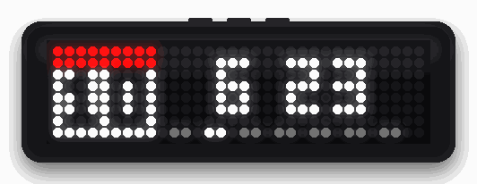
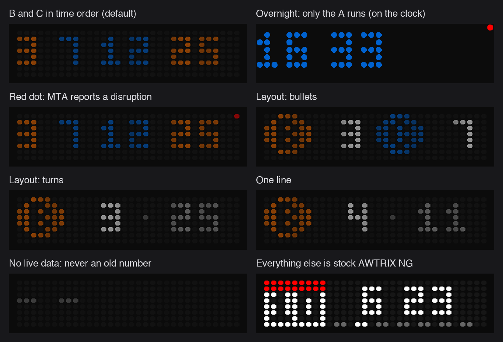
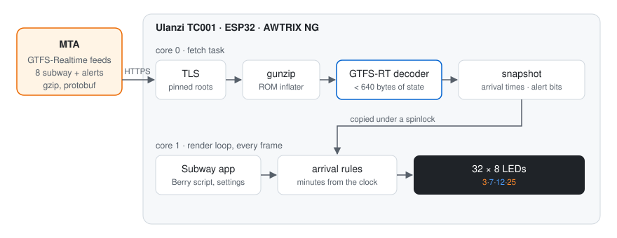

# NYC subway countdown for the Ulanzi TC001

<p align="center"></p>

A pixel clock that shows when your next subway train comes, **live from the MTA, with nothing else
in the loop**: no server, no account, no phone app. The clock downloads the MTA's own real-time
feeds over HTTPS and works out the countdown itself.

It runs on [AWTRIX NG](https://github.com/Blueforcer/awtrix-ng), so it's still a full smart clock
(time, date, auto-brightness, buttons, web UI, notifications, scripts) with one extra app:
**Subway**.

- **Any line, any station.** Up to three lines at one station. The defaults are downtown B, C and A
  at 81 St–Museum of Natural History; change them in the clock's web UI.
- **Glanceable.** The next trains of all lines in time order, each number in its line's MTA color.
  `N` means arriving. No letters to read, unless you pick a layout that shows them.
- **Honest.** Old data is never shown as a countdown: if the feed is stale or unreachable you get
  a gray `- -`. A line that isn't running (the B late at night) simply drops out.
- **Service alerts.** A red dot in the corner while the MTA reports delays or other unplanned
  trouble on your lines. Planned work doesn't count.
- **Polite.** Dims in the dark, switches off in a pitch-black room and stops downloading until the
  lights come on. Downloads are gzipped: about 10–30 KB per update.

## Why this exists

I was graciously hosted by one of my girlfriend's friends: a friend of a friend when I arrived,
and now, very clearly, a friend of mine too. This clock was my thank-you gift. It shows the trains
they actually take, so the next one is a glance away on the way out the door, with no app to open.
That's why the defaults are one particular station and why it ships with a
[card for the box](docs/GIFT_CARD.md). Everything is configurable, so it works as a gift for
anyone in the city.

In the spirit of honesty: this was largely vibe coded with [Claude Code](https://claude.com/claude-code).
I set the direction, tried it on the real clock and made the calls; Claude wrote most of the code,
tests and docs. The commits say so too.

## Get one running

1. **Hardware:** a Ulanzi **TC001** pixel clock (classic ESP32, 4 MB; the TC002 is a different
   device) and a USB-C **data** cable.
2. **Flash it** once over USB with the image from the
   [latest release](https://github.com/jackoregankenny/nyc-subway-clock/releases/latest)
   ([install guide](docs/INSTALL.md)). If your clock already runs AWTRIX NG, upload the update
   file in its web UI instead.
3. **Wi-Fi:** the clock opens a setup hotspot, `awtrixng-…`; join it from your phone and pick your
   network (2.4 GHz).
4. **Your station:** open the clock's address in a browser → **Apps** → gear next to **Subway** →
   Lines, Station ID and Direction from [docs/STATIONS.md](docs/STATIONS.md) (all 496 stations,
   with what N and S mean at each).

The [user guide](docs/USER_GUIDE.md) explains every screen and setting, and the
[FAQ](docs/FAQ.md) covers accuracy, data use and privacy. There's also a
[one-page card](docs/GIFT_CARD.md) to put in the box if you're giving one away.

## What it shows



## How it works



A feed is up to 560 KB of protobuf and the clock has about 120 KB free, so nothing is ever
buffered: bytes go from the socket through the decompressor into the decoder as they arrive. The
whole story, including the ESP32 quirks it took to get there, is in
[docs/HOW_IT_WORKS.md](docs/HOW_IT_WORKS.md).

## This repository

| Path | What |
|---|---|
| [`patches/`](patches) | The firmware change as a patch series on AWTRIX NG `d51e266` (v1.2.3) |
| [`tools/setup-firmware.sh`](tools/setup-firmware.sh) | Clones AWTRIX NG and applies the patches as a `btrain` branch in `firmware/` |
| [`docs/`](docs) | [All the documentation](docs/README.md): install, user guide, stations, FAQ, how it works, development |
| [`preview/`](preview) | 32×8 renders of every state, drawn by the same C++ code as the clock, and captures from a real clock |
| [`tools/`](tools) | Station-list generator, a crosscheck against Google's reference decoder, the image renderer for these docs |

To build the firmware yourself (needs git and [PlatformIO](https://platformio.org)):

```bash
tools/setup-firmware.sh
```

```bash
cd firmware && pio run -e awtrix
```

Testing, previews and moving to a newer AWTRIX NG are in [docs/DEVELOPMENT.md](docs/DEVELOPMENT.md).

## Status

Running on a clock since November 2026. Verified there: live times match the MTA to the
minute, alerts, the overnight A, dark-off, gzip downloads, Wi-Fi re-provisioning. See the
[changelog](CHANGELOG.md).

Limits worth knowing:

- **NYC subway only** (the eight NYCT feeds, including Staten Island Railway). Buses, LIRR and
  Metro-North have other feeds and aren't supported.
- **Three lines per screen at most.** The A and C share a color, so in the numbers layout a blue
  number can be either; the bullets and turns layouts show letters.
- **Updating to an official AWTRIX NG release removes the Subway part.** Use this project's update
  file instead; installing it again brings the Subway screen back.
- **Captive-portal Wi-Fi** (hotel or office login pages) can't work: the clock has no browser.

## License and credits

- **AWTRIX NG** is by Stephan Mühl (Blueforcer) and is source-available under the
  [PolyForm Noncommercial License 1.0.0](LICENSE.md). This project modifies it and is distributed
  under the same license: **free for noncommercial use; you may not sell it, or clocks flashed
  with it.**
- **Train data:** the MTA's real-time feeds ([api.mta.info](https://api.mta.info)), used under the
  MTA's developer terms. **This project is not affiliated with or endorsed by the MTA.** Line
  colors follow the MTA's published route colors so the numbers match the signs.
- **Station list:** the MTA's station directory on data.ny.gov (dataset `39hk-dx4f`).

Required Notice: Copyright © Stephan Mühl (Blueforcer) https://github.com/Blueforcer/awtrix-ng
