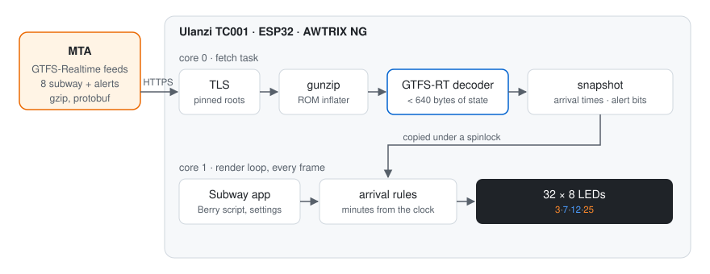

# How it works

The clock is a Ulanzi TC001: a classic ESP32 (two cores at 240 MHz, about 320 KB of RAM, 4 MB of
flash), a 32×8 LED matrix, a light sensor and three buttons. It runs AWTRIX NG, and this project
adds a native module and one script app. Everything happens on the clock.

## The data

The MTA publishes [GTFS-Realtime](https://gtfs.org/realtime/) feeds with no API key: eight subway
feeds, split by line group (`1–7`, `ACE`, `BDFM`, `G`, `JZ`, `L`, `NQRW`, `SI`), plus one for
service alerts. Each is a protobuf message listing every trip on those lines with predicted
times at each stop. The clock wants a few numbers out of it: when the next trains of your lines
reach your platform.

| Feed | Plain | Gzipped |
|---|---|---|
| BDFM (B, D, F, M, shuttle) | ~160 KB daytime, ~60 KB overnight | ~31 KB / ~12 KB |
| ACE (A, C, E, Rockaway shuttle) | ~120 KB | ~22 KB |
| Subway alerts (all lines) | ~555 KB | ~88 KB |

`core/transit/Routes.h` maps each of the 29 route ids to its feed (read off the live feeds), the
MTA's route color and the letter on its bullet. Lines in the same feed share one download, so
B + C + A costs two requests per round (BDFM and ACE), not three.

## Streaming, because nothing fits

With Wi-Fi and TLS up, the clock has about 120 KB free, and the alerts feed alone is 555 KB. So
nothing is ever held in memory:

1. **The fetch task** (FreeRTOS, core 0, low priority) opens an HTTPS connection and hands each
   block of the response to the next stage as it comes off the socket.
2. **Gunzip** strips the gzip framing and feeds the compressed bytes to the ESP32's **ROM
   inflater** (tinfl, from miniz, in mask ROM: no flash used). It needs a 32 KB window and ~11 KB
   of state while a download runs; both are freed afterwards. The CRC-32 and length are checked
   at the end.
3. **The decoder** is a push-style protobuf wire-format reader: it keeps a small stack of open
   messages and the few fields it needs, so its state is fixed at under 640 bytes whatever the
   feed size. It filters trip updates to your routes and stop, drops skipped stops, cancelled and
   deleted trips and duplicates, and keeps the soonest arrivals. In alerts mode it reads each
   alert's active periods, the routes it affects and the MTA's alert type, and keeps one bit per
   line: "disruption now".
4. **The snapshot** (a hundred bytes: arrival times, the feed's timestamp, status) is copied
   under a spinlock to the render side.

The decoder is checked against Google's reference `gtfs-realtime-bindings` on saved and live
feeds (`tools/crosscheck.sh` runs every line), and tested at many chunk sizes: the same answer
whether the bytes arrive one at a time or all at once.

## Showing only what's true

The render loop never shows a stored countdown. Each frame, the Subway app turns the snapshot's
arrival *times* into minutes from the clock's own time (set by NTP), so countdowns tick down
between downloads and are never older than the clock.

| State | When | Screen |
|---|---|---|
| live | fresh feed, trains predicted | the minutes |
| no arrivals | fresh feed, nothing at the stop | that line drops out; with no line left, the app skips its turn |
| stale | the newest good feed is over 120 s old | gray `- -` |
| unavailable | the last download failed and nothing fresh is left | gray `- -` |
| loading / no clock | just booted, or time not set yet | skips |

A train under a minute reads `N` (or `NOW` on the single-line layout), with 30 s of grace before
it disappears. The red dot shows only for alerts fetched in the last 15 minutes and active now;
planned work, extra service, station notices, boarding changes and special schedules don't count.

## Downloading less

- **Gzip** cuts each download to about a fifth. Two ESP32 surprises on the way:
  - Arduino's `HTTPClient` always sends its own `Accept-Encoding: identity…` header, and the MTA's
    server obeys the *first* `Accept-Encoding` it sees. The clock's header rides on the
    `User-Agent` line, which goes out first. (Its HTTP/1.0 mode drops the library header, but the
    MTA doesn't gzip HTTP/1.0.)
  - The ROM inflater reads up to 4 bytes past the end of the compressed data and keeps them, so
    the gzip trailer is read from the last 8 bytes of the stream rather than after the inflater's
    "done".
- Gzip is only asked for when the heap has room for the 43 KB it needs on top of TLS; three
  failures in a row and the clock falls back to plain downloads.
- **Alerts** come every 5 minutes, not every 30 seconds.
- **In the dark** (display off, or below "Off when dark") nothing is downloaded at all. The first
  frame after it lights up triggers an immediate refresh.
- If nobody has asked for arrivals for 5 minutes (the app was removed or switched off), the task
  idles.

Roughly: 2 feeds × ~25 KB every 30 s plus alerts is about 6–7 MB an hour while the display is on.

## Security

TLS certificates are verified against the roots the MTA's endpoint chains to (Amazon Root CA 1–4,
Starfield Services Root G2), pinned in the firmware. A switch in the app's Advanced settings turns
verification off, only as a way out if the MTA changes certificate authority before the firmware
is updated. The clock only talks to the MTA and to an NTP pool for the time.

## Memory and failure handling

- One request at a time, a 25 s deadline per request, and exponential backoff from 15 s to
  5 minutes after failures.
- TLS needs about 40 KB; the task checks the heap first and skips a round rather than fail
  mid-handshake.
- The fetch task (11 KB of stack) is created when the Subway app first runs; a clock without the
  app pays nothing. TLS and gzip buffers exist only during a download: the clock idles at about
  120 KB free and dips to about 28 KB while a gzipped feed streams in.

## The screen

32×8 pixels, AWTRIX's 3×5 font. The layouts are drawn by one header,
`core/transit/SubwayView.h`, shared by the clock and the host preview renderer, so the PNGs in
`preview/` are the pixels the clock shows. Numbers left-align from column 0; at most four trains,
with 3-pixel gaps (2 when tight); column 31, row 0 is never used by text, so the alert dot always
has its pixel.
