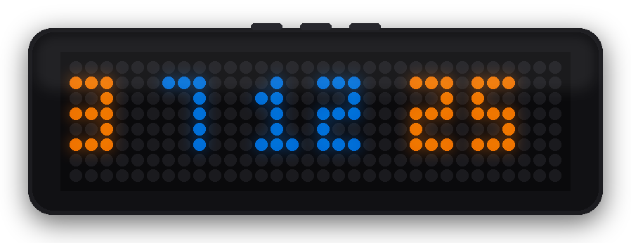

# Documentation

**Using a clock**

- [Install](INSTALL.md): flash a TC001 over USB, or update one that runs AWTRIX NG.
- [User guide](USER_GUIDE.md): what the screens mean, every setting, buttons, Wi-Fi, troubleshooting.
- [Station list](STATIONS.md): every station's ID, its lines, and what N and S mean there.
- [FAQ](FAQ.md): accuracy, data use, privacy, other clocks, licensing.
- [Gift card](GIFT_CARD.md): a one-page card to print and put in the box.

**How it's made**

- [How it works](HOW_IT_WORKS.md): from the MTA's feed to the pixels, on a chip with 120 KB free.
- [Development](DEVELOPMENT.md): build, test, previews, the code map, ESP32 lessons, new upstream releases.
- [Changelog](../CHANGELOG.md)
